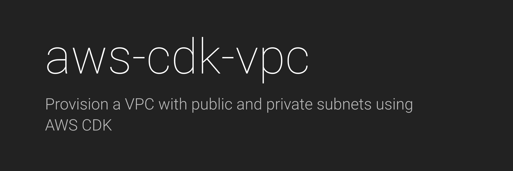

<p align="center">
  
</p>

<p align="center"><strong>Provision a VPC with public and private subnets using AWS CDK</strong></p>

<p align="center">
  <a href="LICENSE"></a>
  <a href="https://github.com/conao3/aws-cdk-vpc/stargazers"></a>
</p>

<p align="center">
  <a href="#overview">Overview</a> |
  <a href="#prerequisites">Prerequisites</a> |
  <a href="#installation">Installation</a> |
  <a href="#deployment">Deployment</a> |
  <a href="#useful-commands">Useful Commands</a> |
  <a href="#license">License</a>
</p>

<h1>aws-cdk-vpc</h1>

## Overview

This project uses AWS CDK (TypeScript) to create a production-ready VPC infrastructure including:

- VPC with configurable naming prefix
- Public subnet with internet access
- Private subnet with NAT egress
- Security group for public resources (SSH access enabled)

## Prerequisites

- Node.js 26 or later
- pnpm
- AWS CLI configured with appropriate credentials
- AWS CDK CLI (`pnpm install` will handle this)

## Installation

```bash
pnpm install
```

## Deployment

Deploy the stack with an environment context:

```bash
pnpm cdk deploy -c env=dev
```

To use a specific AWS profile:

```bash
pnpm cdk deploy -c env=dev --profile <profile-name>
```

## Useful Commands

| Command | Description |
|---------|-------------|
| `pnpm build` | Compile TypeScript to JavaScript |
| `pnpm watch` | Watch for changes and compile |
| `pnpm test` | Run unit tests |
| `pnpm cdk diff` | Compare deployed stack with current state |
| `pnpm cdk synth` | Emit the synthesized CloudFormation template |
| `pnpm cdk destroy` | Remove the deployed stack |

## License

Apache-2.0
